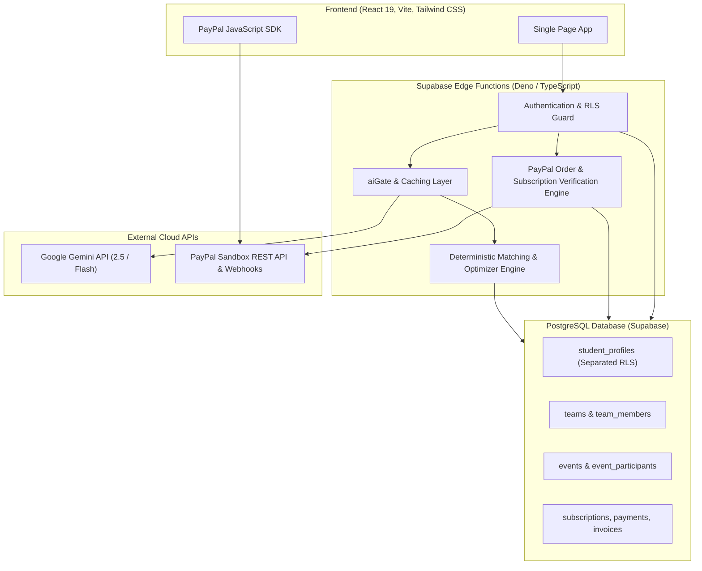

# PayPal AI Hackathon 2026: Official Submission Document

**Project Name:** COLLIVRA  
**Tagline:** Build the right team, not just a full one.  
**Hackathon Theme:** Build What's Next with PayPal and AI  

---

## 1. Executive Summary & Problem Statement

### The Problem
Building a balanced project team is one of the hardest challenges in higher education and technology hackathons:
- **Friendship-Biased Selection:** Students assemble teams based on social connections or whoever replies first. This consistently creates teams with heavy skill redundancy (e.g., three frontend coders and no backend/database specialist), unaddressed skill gaps, and incompatible availability.
- **Black-Box Matching:** Existing matching tools show an unexplained score (e.g., "91% match") with no insight into *why* a candidate fits or what capabilities are missing.
- **No Alternative Trade-off Comparison:** Project creators are forced to accept a single rigid recommendation without comparing trade-offs between skill depth, schedule availability, and domain experience.
- **Hackathon Scaling Bottlenecks:** Hackathon organisers spend days manually reviewing spreadsheets trying to group hundreds of individual registrants into balanced teams.
- **Monetization Conflation:** Many student platforms force event organisers into consumer recurring plans or force students to pay for event creation tools, breaking trust on both sides.

### The Solution: COLLIVRA
COLLIVRA is an explainable collaborative platform designed around three pillars:
1. **Google Gemini AI & Semantic Understanding:** Extracts project roles, detects hidden skill gaps, and evaluates semantic terminology without hallucinating arbitrary scores.
2. **Deterministic, Explainable Matching & Alternative Team Comparison:** Evaluates real candidate profiles using transparent weights, enforces a skill gateway, and generates up to **three genuinely distinct alternative team combinations** (Team A, Team B, Team C) with real calculated scores.
3. **PayPal-Powered Tiered Business Model:** Decouples **Student Premium Subscriptions** ($2.99/mo or $24.99/yr via PayPal Subscriptions API) from one-time **Event Passes** ($9, $19, $39 via PayPal Orders API), backed by signature-verified webhooks and automated PDF invoices.

---

## 2. Target Users

1. **University & College Students:** Students seeking complementary collaborators for hackathons, open-source projects, and capstone coursework.
2. **Hackathon Organisers & Student Clubs:** Technical organizers needing to form dozens or hundreds of balanced teams in one automated, fair pass.
3. **Academic Professors & Industry Experts:** Mentors providing subject-matter expertise and architectural reviews to student project teams.

---

## 3. Core Implemented Functionality

### 3.1 AI Project Analysis & Semantic Understanding
- Gemini extracts required technical roles, required experience, and skill gaps from project descriptions.
- Built-in taxonomy resolves common aliases (e.g., `JS` $\to$ `JavaScript`, `ML` $\to$ `Machine Learning`, `Postgres` $\to$ `PostgreSQL`) locally without network overhead.
- Gemini only judges unfamiliar terminology; backend code validates every string against real student profiles before computing scores.

### 3.2 Alternative Team Comparison (Phase 2 Enhancement)
- Generates up to three distinct combinations for the same project:
  - **Team A — Strongest Skill Coverage:** Maximizes skill coverage and depth across project requirements.
  - **Team B — Optimal Availability Alignment:** Prioritizes compatible and sufficient weekly working hours among candidates.
  - **Team C — Balanced Experience & Domain Fit:** Prioritizes domain interest alignment and an experienced lead with motivated contributors.
- Every score ($0-100\%$) is mathematically calculated from real student profiles.
- Displays full 5-part breakdown (Skill, Interest, Availability, Experience, Diversity), missing skills, redundant skills, and individual role assignments.
- Selecting an alternative creates **only that single team** in the database upon user confirmation.

### 3.3 Mentor Discovery & Recommendations (Phase 3 Enhancement)
- Recommends verified **College Professors** and **Industry Experts** alongside the team comparison.
- Supports category filtering (`college_professor`, `industry_expert`, or both) and project preference settings.
- Displays match percentage, domain relevance, technical expertise, and session booking via `MentorBookingModal`.

### 3.4 Event-First Organiser Experience & Analytics (Phase 4 Enhancement)
- Event Organisers create multi-stage hackathons, publish via an Event Pass, and manage participant registrations.
- **No Student Premium Required:** Organisers access complete **Event Analytics** directly at `/analytics` without requiring a student subscription:
  - Total events (published, draft, in-progress)
  - Total participant registrations
  - Teams formed and average team compatibility score
  - Registration activity trends over the last 6 weeks
  - Skill demand analysis (% of participants possessing required focus skills)
  - Academic branch diversity representation
- Data is strictly scoped to the organiser's owned events (`organizer_id = auth.uid()`).

### 3.5 Strictly Preserved Student Premium (Phase 5)
- **Monthly Student Premium ($2.99/mo)** and **Yearly Student Premium ($24.99/yr)** are preserved.
- PayPal Subscriptions API manages recurring payments, renewal periods, and cancellations.
- Premium students unlock 150 monthly AI actions, team risk analysis, what-if simulator, student project analytics, and mentor collaboration.

### 3.6 Event Pass System (Phase 6)
- Independent one-time payment for event publishing:
  - Standard ($9.00): Up to 3 stages, manual judging
  - Advanced ($19.00): Up to 10 stages, team submissions, automatic advancement
  - Complex ($39.00): Unlimited stages, weighted judging rubrics

### 3.7 Student & Organiser Profile Separation (Phase 7)
- Organiser profiles are private and completely shielded from student discovery and direct URL inspection (`/profile/:id`).
- Database Row Level Security policy enforces that non-owner users can only select student profiles.
- Public event discovery is preserved: students discover published events and register freely.

---

## 4. How AI and PayPal Work Together

A central design principle in COLLIVRA is strict architectural separation of concerns:
- **PayPal** does **not** make AI matching decisions.
- **Gemini AI** does **not** process financial transactions or make payment authorization decisions.

Instead, the two systems interact cleanly through **server-side entitlement gates**:
1. **Payment Gates Capability:** When a user initiates a PayPal transaction, Supabase Edge Functions verify the payment directly with PayPal's REST APIs.
2. **Entitlements Unlock AI:** Upon verified server capture or subscription activation, the user's tier is elevated, granting higher monthly Gemini AI allowances (from 15 to 150) and unlocking advanced tools (team risk analysis and what-if simulation).
3. **Resilience & Fallbacks:** If the Gemini API is temporarily rate-limited or unavailable, COLLIVRA falls back to tested, deterministic rule-based algorithms. The platform never breaks, never invents candidates, and never fakes scores.

---

## 5. Technical Architecture

---

## 6. Business Model

| Offering | Target User | Pricing Model | Delivery Mechanism |
|---|---|---|---|
| **Student Free** | Students | $0.00 / forever | 15 AI actions/month, basic matching, workspace |
| **Student Premium** | Active Students | $2.99/mo or $24.99/yr | PayPal Subscriptions API (150 AI actions, risk analysis, analytics, mentors) |
| **Event Pass** | Event Organisers | $9 / $19 / $39 one-time per event | PayPal Orders API (Single-event publishing, automated batch team formation) |
| **Enterprise** | Universities / Sponsors | Custom contract | Dedicated agreements & custom invoices |

---

## 7. Safety, Security & Compliance

- **One-Way Financial Direction:** All money moves strictly from customer to COLLIVRA. There are no payouts, pooled wallets, or user-to-user transfers.
- **Server-Side Verification:** A database trigger and RLS prevent anyone marking an event paid or a subscription active from the client browser.
- **Webhook Signature Verification:** Webhooks verify `PAYPAL-AUTH-ALGO`, `PAYPAL-CERT-URL`, and `PAYPAL-TRANSMISSION-SIG` before updating state.
- **Immutable Invoices:** Invoices are generated exclusively for completed payments and are protected by user ownership policies.
- **Profile Privacy:** Event Organisers' private information is inaccessible to students.

---

## 8. Verification & Test Suite Results

The codebase contains an extensive automated test suite executed via `npm test`:

- `test:optimizer` — Validates deterministic team optimization, snake drafting, and alternative team diversity.
- `test:enhancements` — Validates alternative team comparison, dynamic badges, organiser analytics, and profile separation.
- `test:insights` — Validates risk scoring, what-if team simulation, and fallback reasoning.
- `test:plans` — Ensures price, plan key, and entitlement consistency across frontend and backend.
- `test:payments` — Verifies server-side rejection of tampered PayPal orders and subscriptions.
- `test:invoices` — Tests PDF invoice generation from verified payments.
- `test:skill-matching` — Tests the skill-first gateway, semantic normalization, and alias dictionary.
- `test:event-first` — Tests direct event ownership and participant management permissions.
- `check:imports` — Validates static import resolution across all 86 project source files.

**Build Status:** `vite build` completed cleanly with production bundle optimization.

---

## 9. Implemented vs. Future Scope

### Implemented Today
- Alternative team comparison (Team A, Team B, Team C) with real scoring
- Professor and industry mentor recommendations with booking workflow
- Full organiser event analytics without Student Premium
- Preserved Student Premium monthly ($2.99) and yearly ($24.99) plans
- Preserved Event Passes ($9, $19, $39)
- Student and Organiser profile separation
- Verified PayPal Subscriptions, Orders, Webhooks, and Invoices

### Future Scope
- Automated Google Calendar and Microsoft Outlook integration for scheduled mentor sessions
- Multi-currency PayPal automatic currency conversion for international student hackathons
- Real-time mobile push notifications for team invites and stage advancement announcements

---

## 10. Conclusion

COLLIVRA proves that AI and payments work best when their responsibilities are well-defined: **Gemini AI** provides semantic interpretation and human-readable coaching; **deterministic algorithms** compute fair, transparent scores; and **PayPal** provides secure, server-verified monetization that respects students and event organisers as distinct audiences.
