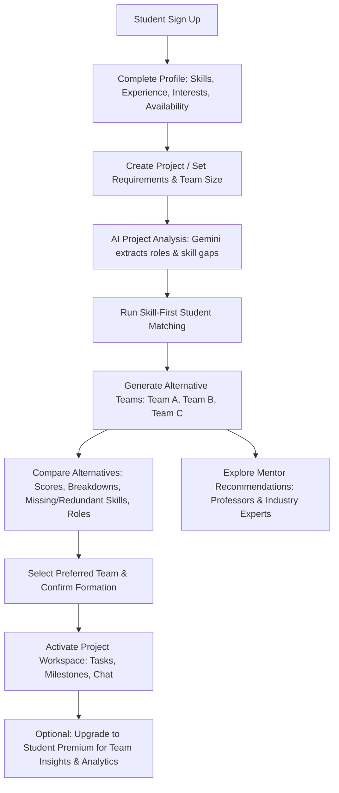
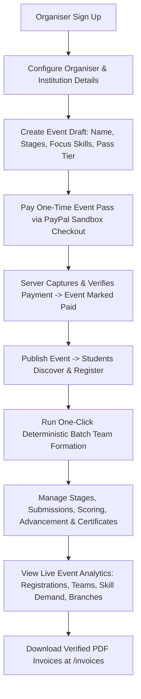
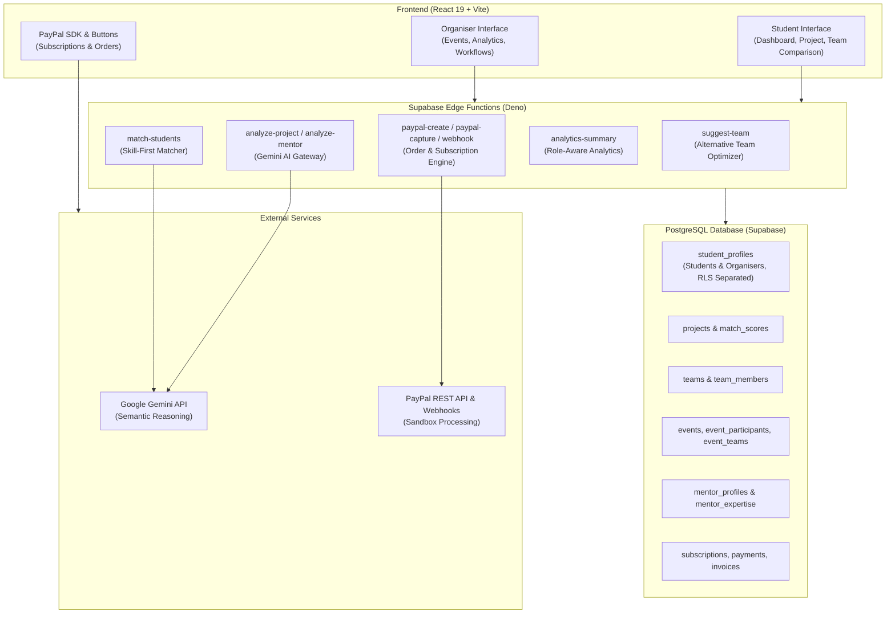

# COLLIVRA

> **Build the right team, not just a full one.**  
> Explainable, skill-first team formation, AI-driven project analysis, alternative team comparison, and professor & industry mentor discovery — powered by PayPal and Google Gemini.

Built for the **PayPal AI Hackathon 2026** (Theme: *Build What's Next with PayPal and AI*).

---

## 1. Project Introduction

**COLLIVRA** is a collaborative platform designed to eliminate guesswork and interpersonal bias when students assemble project teams and when colleges or hackathon organizers form balanced teams across an entire cohort. 

Instead of matching students based on popularity or arbitrary percentage scores, COLLIVRA implements an **explainable, skill-first algorithm** combined with **Google Gemini AI** for semantic requirement extraction and **PayPal** for secure subscription and event billing.

---

## 2. Problem Statement

1. **Friendship-Based Team Assembly Fails:** Student hackathon and capstone teams are typically assembled by friendship or rapid social responses. This leads to redundant skills (e.g., three frontend coders and no database engineer), skill gaps, and schedule mismatches.
2. **Black-Box Matching Engines:** Traditional matching tools present an arbitrary percentage (e.g., "89% match") without explaining *why* a candidate fits, which skills are covered, or what is missing.
3. **No Alternative Exploration:** Project leaders have no way to compare trade-offs between different team combinations (e.g., maximum skill coverage vs. optimal schedule availability).
4. **Cohort Balancing is Unscalable:** College hackathons and event organizers waste days manually grouping hundreds of students into balanced teams.
5. **Separation of Monetization Models:** Student platforms frequently conflate recurring consumer subscriptions with institutional event-organizer fees, breaking user trust.

---

## 3. Proposed Solution

COLLIVRA provides:
- **Skill-First Gateway Matching:** Students appear as candidates only if they possess genuine, verified project skills.
- **Alternative Team Comparison:** Generates up to three genuinely different candidate teams (Team A, Team B, Team C) with real compatibility scores, dynamic badges, breakdown charts, missing/redundant skills, and role assignments.
- **Explainable Matching Breakdown:** Every recommendation is backed by transparent weights (Skills 65%, Role 15%, Interest 10%, Availability 5%, Collaboration 3%, Experience 2%).
- **Professor & Industry Mentor Recommendations:** Intelligent discovery connecting project needs with academic professors and industry experts.
- **Event-First Organiser Experience:** Event Organisers create multi-stage hackathons, publish via a single-event **Event Pass**, and access live **Event Analytics** without requiring a Student Premium subscription.
- **Server-Verified PayPal Monetization:** Monthly & Yearly Student Premium subscriptions via PayPal Subscriptions API, one-time Event Passes via PayPal Orders API, signature-verified webhooks, and tamper-proof PDF invoices.

---

## 4. Key Features

- **Multi-Factor Student Matching:** Evaluates skill overlap, experience level, project interests, availability, and branch diversity.
- **Alternative Team Comparison (Phase 2):** Compare Team A (e.g., *Strongest Skill Coverage*), Team B (*Optimal Availability Alignment*), and Team C (*Balanced Experience & Domain Fit*).
- **Comprehensive Mentor Matching (Phase 3):** Dual-track discovery for College Professors and Industry Experts with transparent scoring and session booking.
- **Role-Aware Event Organiser Access (Phase 4):** Event Organisers access full event analytics, participant insights, registration trends, and stage management without purchasing Student Premium.
- **Strictly Preserved Student Premium (Phase 5):** Monthly ($2.99/mo) and Yearly ($24.99/yr) plans unlocking 150 AI actions, risk analysis, what-if simulator, student analytics, and mentor collaboration.
- **Independent Event Pass System (Phase 6):** One-time per-event payment ($9 Standard, $19 Advanced, $39 Complex) unlocking publishing and automated batch team formation.
- **Strict Profile Separation (Phase 7):** Private organiser profiles are shielded from student discovery and direct URL inspection while preserving public event discovery.
- **Automated PDF Invoices:** Generated exclusively from server-verified completed PayPal payments.

---

## 5. Student Account Workflow



---

## 6. Event Organiser Account Workflow



---

## 7. Student Premium Subscriptions

Student Premium is specifically tailored for students conducting serious project work:

| Plan | Price (USD) | Interval | AI Actions | Key Features Included |
|---|---|---|---|---|
| **Student Free** | $0.00 | Forever | 15 / month | Profile, project creation, basic matching, workspace (tasks, milestones, chat) |
| **Student Premium (Monthly)** | $2.99 | Monthly | 150 / month | Team risk analysis, what-if simulator, student analytics, mentor booking & collaboration |
| **Student Premium (Yearly)** | $24.99 | Yearly | 150 / month | All Monthly features with a 30% yearly discount |

> **Preservation Rule:** Student Premium is verified server-side through PayPal Subscriptions API (`custom_id` matching and `ACTIVE` status). Organisers do not need Student Premium, and Student Premium entitlements remain strictly enforced for students.

---

## 8. AI-Powered Project Analysis

COLLIVRA uses **Google Gemini 2.5/Flash** through Supabase Edge Functions with quota-gated safety:
- **Role Identification:** Analyzes the project description and domain to identify required technical roles (e.g., *Full-Stack Engineer*, *ML Pipeline Architect*, *UI/UX Designer*).
- **Skill Gap Detection:** Identifies critical prerequisites not mentioned in the brief.
- **Sustainability & Architecture Guidance:** Suggests practical coordination strategies for distributed student teams.
- **Fallback Resilience:** If Gemini is unreachable or user quota is reached, a deterministic rule-based analysis is returned instantly without crashing the interface.

---

## 9. Alternative Team Comparison

When requesting team recommendations for a project, COLLIVRA generates up to **three genuinely different candidate combinations**:

- **Team A — Strongest Skill Coverage:** Optimizes for maximum depth and coverage on project-required skills.
- **Team B — Optimal Availability Alignment:** Prioritizes candidates with high and compatible weekly working hours to reduce coordination friction.
- **Team C — Balanced Experience & Domain Fit:** Prioritizes domain interest alignment with a healthy hierarchy (experienced leads paired with motivated junior contributors).

Each alternative presents:
- Actual calculated compatibility score ($0-100\%$)
- Five-dimension breakdown: Skill ($35\%$), Interest ($20\%$), Availability ($15\%$), Experience ($15\%$), Diversity ($15\%$)
- Dynamically determined distinction badge
- Missing skills and redundant skills tags
- Member list with specific assigned roles
- Transparent "Why this team?" reasoning and practical coaching guidance

Only the selected alternative is created in the database upon user confirmation, avoiding ghost teams.

---

## 10. Explainable Matching Engine

Scoring is deterministic and transparent:
$$\text{Score} = 0.65 \times \text{Skill} + 0.15 \times \text{Role} + 0.10 \times \text{Interest} + 0.05 \times \text{Availability} + 0.03 \times \text{Collaboration} + 0.02 \times \text{Experience}$$

- **Skill Gateway:** A student with $0\%$ skill match is completely excluded from recommendations.
- **Semantic Resolution:** Built-in alias dictionary handles abbreviations (`JS` $\to$ `JavaScript`, `ML` $\to$ `Machine Learning`) without consuming AI quota. Gemini resolves unknown semantics with strict profile validation.

---

## 11. Professor & Industry Mentor Recommendations

Mentorship complements student project execution:
- **College Professors:** Academic advisors with institutional verification, research expertise, and university affiliations.
- **Industry Experts:** Professional practitioners providing architectural reviews, tech stack advice, and industry best practices.
- **Dual Matching:** Projects can indicate preferences (`college_professor`, `industry_expert`, `both`, or `none`).
- **Real Profiles:** Matches are computed from normalized `mentor_profiles`, `mentor_expertise`, and `mentor_availability` tables.

---

## 12. Event Creation & Management

Organisers manage hackathons from start to finish:
- Multi-stage event workflows (registration, submission, judging, advancement, results).
- Automated advancement rules (score threshold or top-N participants).
- One-click deterministic team optimizer snake-drafting and balancing hundreds of students into fair teams.
- Digital certificate generation for event participants.

---

## 13. Event Pass System

Event Passes are one-time payments decoupled from recurring subscriptions:

| Pass Tier | Price (USD) | Workflow Stages | Team Submissions | Advancement Logic |
|---|---|---|---|---|
| **Standard** | $9.00 | Up to 3 stages | Individual only | Manual judging |
| **Advanced** | $19.00 | Up to 10 stages | Team submissions included | Score threshold or top-N automatic advancement |
| **Complex** | $39.00 | Unlimited stages | Team submissions included | Weighted multi-criteria judging rubric |

---

## 14. PayPal Integration Architecture

COLLIVRA integrates deeply with the PayPal Developer Sandbox:
1. **Subscriptions API:** Manages Student Premium plans (`premium_monthly`, `premium_yearly`). Subscriptions are activated only after server-side retrieval confirms `status: 'ACTIVE'` and matching `custom_id`.
2. **Orders API:** Facilitates one-time Event Pass checkout. Server sets price, captures order, and checks amount, currency, and event ID before marking an event paid.
3. **Webhooks:** Listens to `PAYMENT.CAPTURE.COMPLETED`, `BILLING.SUBSCRIPTION.CANCELLED`, and `CUSTOMER.DISPUTE.CREATED` with cryptographic header verification (`PAYPAL-AUTH-ALGO`, `PAYPAL-CERT-URL`, `PAYPAL-TRANSMISSION-SIG`).
4. **Verified PDF Invoices:** Client-rendered PDF invoices generated directly from immutable database payment records.

---

## 15. Technology Stack

- **Frontend:** React 19, Vite 5, Tailwind CSS 3, React Router 7, `@dnd-kit`
- **Backend & Database:** Supabase (PostgreSQL 15, Row Level Security, Auth, Storage)
- **Serverless Compute:** Deno Edge Functions (TypeScript)
- **AI Engine:** Google Gemini 2.5 / Flash with local rule-based fallbacks
- **Payments:** PayPal Subscriptions API, PayPal Orders API, PayPal Webhooks
- **Testing:** Node.js 22 native test runner (`node --experimental-strip-types`)

---

## 16. System Architecture



---

## 17. Application Navigation & Entitlement Matrix

| Page / Route | Student (Free) | Student (Premium) | Event Organiser |
|---|---|---|---|
| `/dashboard` | Allowed (Projects & Network) | Allowed | Redirected to `/events` |
| `/team/:id/recommend` | Allowed (3 Alternatives) | Allowed (3 Alternatives) | N/A |
| `/mentors` | View list only | Full booking & contact | N/A |
| `/analytics` | Upgrade Notice shown | Project & Task Analytics | Full Event Analytics (No subscription required) |
| `/events` | Discover published events | Discover published events | Full Event Management & Draft Creation |
| `/profile/:id` | View other students | View other students | Cannot be viewed by students (Private) |

---

## 18. Local Installation

```bash
# Clone the repository
git clone https://github.com/your-username/collivra.git
cd collivra

# Install dependencies
npm install

# Start development server
npm run dev
```

---

## 19. Environment Variables

Create `.env` in the project root:

```env
# Supabase Configuration
VITE_SUPABASE_URL=https://your-project.supabase.co
VITE_SUPABASE_ANON_KEY=your-supabase-anon-key

# PayPal Sandbox Configuration
VITE_PAYPAL_CLIENT_ID=your-paypal-sandbox-client-id
VITE_PAYPAL_ENV=sandbox
```

In `supabase/functions.env` (kept private on server):

```env
GEMINI_API_KEY=your-gemini-api-key
PAYPAL_CLIENT_ID=your-paypal-sandbox-client-id
PAYPAL_CLIENT_SECRET=your-paypal-sandbox-client-secret
PAYPAL_WEBHOOK_ID=your-paypal-webhook-id
PAYPAL_PLAN_PREMIUM_MONTHLY=your-monthly-plan-id
PAYPAL_PLAN_PREMIUM_YEARLY=your-yearly-plan-id
```

---

## 20. Supabase Setup & Deployment

1. Apply migrations in sequence:
   ```bash
   npx supabase db push
   ```
2. Deploy Edge Functions:
   ```bash
   npx supabase functions deploy suggest-team
   npx supabase functions deploy match-students
   npx supabase functions deploy analyze-project
   npx supabase functions deploy analyze-mentor-requirements
   npx supabase functions deploy analytics-summary
   npx supabase functions deploy form-event-teams
   npx supabase functions deploy paypal-create-order
   npx supabase functions deploy paypal-capture-order
   npx supabase functions deploy paypal-webhook
   npx supabase functions deploy subscription-manage
   npx supabase functions deploy invoice-manage
   ```

---

## 21. Security & Privacy

- **Row Level Security (RLS):** Enforced across all tables.
- **Profile Separation (Phase 7):** `student_profiles` SELECT policy strictly shields organiser profiles from students:
  `USING (id = auth.uid() OR COALESCE(account_type, 'student') = 'student')`
- **Ownership Verification:** Payment records, invoices, and event management actions verify `auth.uid() = organizer_id` or `auth.uid() = user_id`.
- **Zero Financial Exfiltration:** Payment transactions flow strictly one-way (User $\to$ COLLIVRA via PayPal). No user-to-user transfers or wallet balances exist.

---

## 22. Verification & Automated Test Suite

COLLIVRA includes an automated test suite executing under Node 22+:

```bash
npm test
```

Verification includes:
- `test:optimizer`: Multi-criteria snake-drafting and team balancing
- `test:enhancements`: Alternative team diversity, dynamic badges, organiser analytics, profile privacy
- `test:insights`: Risk analysis and what-if simulation
- `test:plans`: Synchronization between server and browser plan definitions
- `test:payments`: Tampered payment defense (wrong user, wrong plan, underpayment)
- `test:invoices`: PDF invoice generation and transaction mapping
- `test:skill-matching`: Semantic matching and gateway rules
- `test:event-first`: Direct event ownership and permission checks
- `check:imports`: Comprehensive static import resolution across all 86 modules

---

## 23. Known Limitations

- **PayPal Sandbox:** Runs against the PayPal Developer Sandbox. Live production credentials require PayPal business verification.
- **Offline Mock Mode:** When `.env` is absent, the app runs in local mock mode with simulated responses for local testing.

---

## 24. Future Roadmap

- Automated calendar sync for mentor booking sessions (Google Calendar / Outlook integration).
- Multi-currency PayPal localized pricing for international student chapters.
- Mobile push notifications via Supabase Realtime and web push standards.

---

## 25. Team & Acknowledgements

- Built for the **PayPal AI Hackathon 2026**.
- Powered by **PayPal Developer Platform** and **Google Gemini AI**.
- Built with React, Vite, Tailwind CSS, Supabase, and Deno.

---

## 26. License

MIT License. See [LICENSE](LICENSE) for details.
